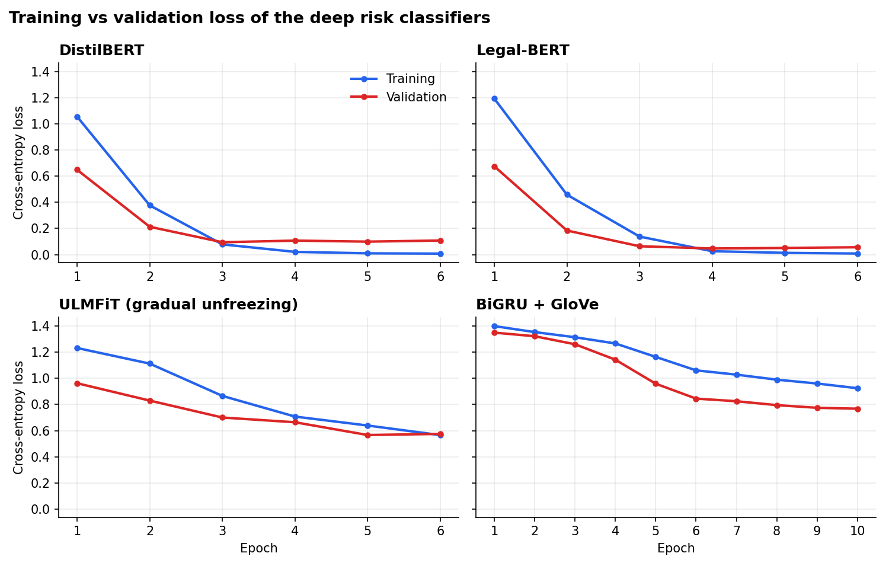

# AI Act RAG Navigator

A risk-aware Retrieval-Augmented Generation (RAG) assistant for the EU AI Act (Regulation (EU) 2024/1689).

You describe your AI product and ask a compliance question. The system first classifies the product into one of the four AI Act risk tiers, then uses that label, together with your role (provider, deployer, and so on), to steer retrieval over the text of the regulation. The LLM answers only from the retrieved articles and cites them.

[](https://colab.research.google.com/github/profsuccodifrutta/ai_act_RAG_navigator/blob/main/NaN_project.ipynb)

Live demo: [AI Act Advisor on Hugging Face Spaces](https://huggingface.co/spaces/profsuccofrutta/ai-act-advisor). You'll need your own Hugging Face token to use it (see [Using the live demo](#using-the-live-demo)).

Built as the project for the Data Visualization and Text Mining course in the MSc in Data Science.

## Why

General-purpose LLMs sound sure of themselves on the AI Act and still get basic things wrong. In our tests a plain LLM labelled workplace emotion recognition as high-risk and walked through compliance steps for it, even though the Act prohibits it outright. It told the owner of an e-commerce FAQ chatbot (limited risk) that they needed a quality management system and technical documentation. It also claimed the Act does not require CE marking for high-risk systems, which contradicts Article 48.

Running the classifier first and limiting the model to retrieved legal text gave the right answer in all three cases.

## How it works

```
 user's product description ──► risk classifier (DistilBERT)
                                        │
             ┌──────────────────────────┴─────────────────────────┐
     Unacceptable_Risk                                   High / Limited / Minimal
             │                                                    │
    guardrail: fixed "prohibited"              hybrid retrieval (BM25 + FAISS, RRF)
    alert, no LLM call                                            │
                                         metadata re-ranking on role + risk level
                                                                  │
                                         prompt with retrieved chunks ──► Gemma-2-2B-it
                                                                  │
                                                  answer with article citations
```

### 1. Parsing the regulation

`parse_ai_act_robust()` reads `ai_act_2024.pdf` with PyMuPDF and turns it into clean legal units. It strips page headers, ELI references, page numbers, line-break hyphenation and footnotes, then tags each page as RECITAL, ARTICLE or ANNEX. Text is split only at real structural headings, so an inline mention of "Article 99" does not start a new unit.

### 2. Chunking and metadata enrichment

Units are cut with `RecursiveCharacterTextSplitter` into chunks of up to 1500 characters with a 200-character overlap. Each chunk starts with its legal identifier (for example `[ARTICLE 10] ...`) so the reference is still there after retrieval.

A spaCy `en_core_web_sm` pipeline with a custom EntityRuler, placed before the statistical NER, tags domain entities: `LEGAL_ROLE` (provider, deployer, ...), `RISK_LEVEL`, `ORG`, `CONCEPT` and `DOCUMENT`. We refined the rules over several rounds of error analysis, inspecting samples with displaCy each time.

Chunks shorter than 100 characters are dropped, which takes the count from 577 to 570. The result is saved to `data/polished_chunks.json`.

### 3. Exploratory analysis

Plotly charts show unit and chunk length distributions, counts per category, entity type frequencies, and a TF-IDF ranking of terms across the corpus.

### 4. Embeddings and vector store

Chunks are embedded with BAAI/bge-m3 using normalized vectors, which turns cosine similarity into an inner product. The model is multilingual, so a user can ask in their own language and still hit the English text. Vectors are stored in a FAISS index under `ai_act_rag_index/`.

### 5. Retrieval

A LangChain `EnsembleRetriever` runs BM25 (weight 0.3) and FAISS (weight 0.7) side by side and merges them with Reciprocal Rank Fusion.

On top of that, `retrieve_and_filter_chunks` fetches 60 candidates, rebuilds a min-max normalized RRF score from each one's rank, and blends it with a metadata score based on fuzzy matching of role and risk level:

`final = 0.8 · semantic + 0.2 · metadata`

Chunks scoring under 40% of the top chunk are dropped, and the best 5 are kept.

This matters for questions like "how long must I keep system logs?" asked by a high-risk provider. Plain semantic search puts Article 26 first, but Article 26 covers deployers. With re-ranking, the provider obligations in Articles 18, 19 and 22 move to the top.

### 6. Risk classifier

The classifier is trained on a synthetic dataset generated with Gemini (`ai_risk_dataset2.csv.txt`, about 980 product descriptions balanced across the four labels). Every model uses the same stratified 80/10/10 split.

| Model | Accuracy | F1 macro | Recall macro | ROC AUC |
|---|---|---|---|---|
| DistilBERT (selected) | **96.94%** | **0.9696** | **0.9696** | 0.9939 |
| Legal-BERT | 96.94% | 0.9692 | 0.9692 | **0.9944** |
| Random Forest (TF-IDF) | 92.86% | 0.9292 | 0.9279 | 0.9923 |
| Linear SVM (TF-IDF) | 92.86% | 0.9284 | 0.9283 | 0.9859 |
| ULMFiT (AWD-LSTM, domain-adapted on the AI Act) | 84.69% | 0.8458 | 0.8475 | 0.9811 |
| XGBoost (TF-IDF) | 83.67% | 0.8386 | 0.8367 | 0.9629 |
| BiGRU + GloVe 100d | 63.27% | 0.6200 | 0.6312 | 0.9079 |

The no-information rate is 25.51%. DistilBERT matches Legal-BERT with about 60% of the parameters, so the pipeline uses DistilBERT.



Both BERT models converge within three epochs. After that, training loss keeps falling toward zero while validation loss levels off around 0.1 (DistilBERT) and 0.05 (Legal-BERT). The ULMFiT curve covers the six epochs of gradual unfreezing, and its validation loss stops improving at about 0.57. The BiGRU learns slowly: after ten epochs its validation loss is still 0.77. The curves come from the training logs saved in the notebook, so no model was retrained to draw them.

### 7. Generation

Answers come from google/gemma-2-2b-it, run locally through a Hugging Face pipeline with temperature 0.1 and up to 512 new tokens. `build_super_prompt()` writes the user's risk tier and role into the system instructions, tells the model to use only the retrieved context, and requires article citations.

When the classifier returns `Unacceptable_Risk`, the pipeline stops there and returns a fixed alert without calling the LLM.

### 8. Evaluation

The notebook ends with three case studies. Each one is also run through the same LLM without RAG for comparison.

| Case | Plain LLM | This system |
|---|---|---|
| Emotion recognition at work and school | Calls it high-risk and lists compliance steps | Classified as unacceptable; the guardrail stops it |
| E-commerce FAQ chatbot | Says a QMS and technical docs are required | Classified as limited risk; no high-risk obligations, cites Art. 17 and Annex VII |
| CE marking for high-risk systems | Says CE marking isn't required | Correct, cites Art. 48 and Art. 49(1) |

## Repository contents

| File | What it is |
|---|---|
| `NaN_project.ipynb` | The full pipeline: parsing, EDA, NER, embeddings, retrieval, classifiers, generation, evaluation |
| `ai_act_2024.pdf` | Official text of the EU AI Act (Regulation 2024/1689) |
| `ai_risk_dataset2.csv.txt` | Synthetic training set for the risk classifier (`text`, `label`) |
| `pyproject.toml`, `uv.lock` | Dependencies, managed with `uv` |
| `assets/loss_curves.png` | Loss curves shown above |
| `.github/workflows/security.yml` | Weekly security check (see [Security](#security)) |

Running the notebook also creates these files, which are not committed: `data/polished_chunks.json`, `ai_act_rag_index/`, `distilBERT_classifier/`, `legalBERT_classifier/`, `ulmfit_ai_risk_classifier.pkl`, and the GloVe files.

## Using the live demo

The Space has no token of its own. Every answer is generated on the visitor's Hugging Face account, so you pay for (or use the free credits of) your own requests.

1. Create a fine-grained token at [huggingface.co/settings/tokens](https://huggingface.co/settings/tokens) with only the "Make calls to Inference Providers" permission.
2. Paste it into the "Your Hugging Face Access Token" field in the app.

The token is used for that one request. The app doesn't store it, log it, or show it in error messages. Requests without a token are rejected before any work runs.

## Running the notebook

The notebook targets Google Colab with a GPU runtime, since embedding and fine-tuning use CUDA.

1. Open the notebook with the Colab badge above.
2. Accept the license for [`google/gemma-2-2b-it`](https://huggingface.co/google/gemma-2-2b-it) on Hugging Face, create an access token, and save it in Colab Secrets as `hf_gemma`.
3. Run all cells. The first ones clone this repo, install `uv` and the dependencies, and load the PDF and dataset from the repo root.

You can run it locally too, but you'll have to remove the `google.colab` imports (Drive and `userdata`) and pass the Hugging Face token some other way.

## Limitations

The classifier is trained on synthetic data. Real product descriptions tend to be vaguer, and labels written by an LLM may be wrong on borderline legal cases. Generation is evaluated qualitatively on three case studies, not on a benchmark. Gemma-2-2B is a small model, so its answers stay grounded but can be shallow.

This is a course project and not legal advice.

## Security

No credentials are kept in this repository or in the Space. The notebook reads its Hugging Face token from Colab Secrets, and the Space uses each visitor's token.

A GitHub Actions workflow ([security.yml](.github/workflows/security.yml)) runs on every push and every Monday. It checks four things:

- the full git history of this repo has no leaked secrets (gitleaks);
- the full git history of the Space has none either;
- the Space code never reads a token from its environment, so it can't spend the owner's credits;
- the Space runs on the free `cpu-basic` hardware.

If a check fails, GitHub emails the repo owner. Findings show up as annotations on the run's summary page, with the secret itself redacted. [.gitleaks.toml](.gitleaks.toml) whitelists two notebook metadata fields that look like keys but aren't: Colab's `authorship_tag` and Jupyter widget IDs.

## Tech stack

PyMuPDF, spaCy, LangChain, FAISS, rank-bm25, sentence-transformers (BGE-M3), Hugging Face Transformers, fastai, TensorFlow/Keras, scikit-learn, XGBoost, Plotly.
